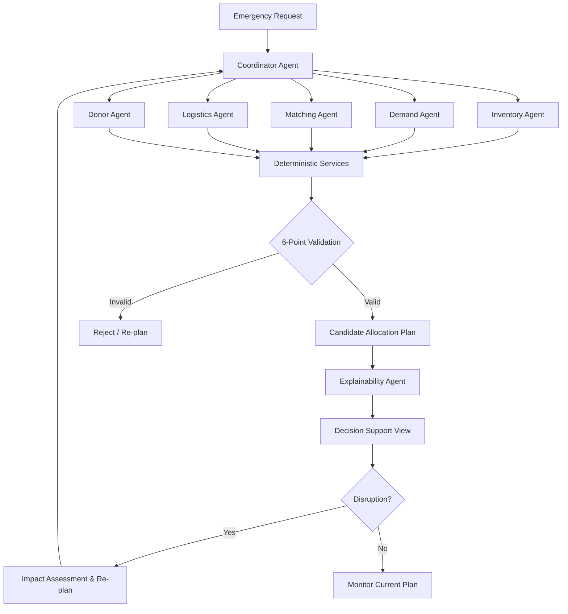
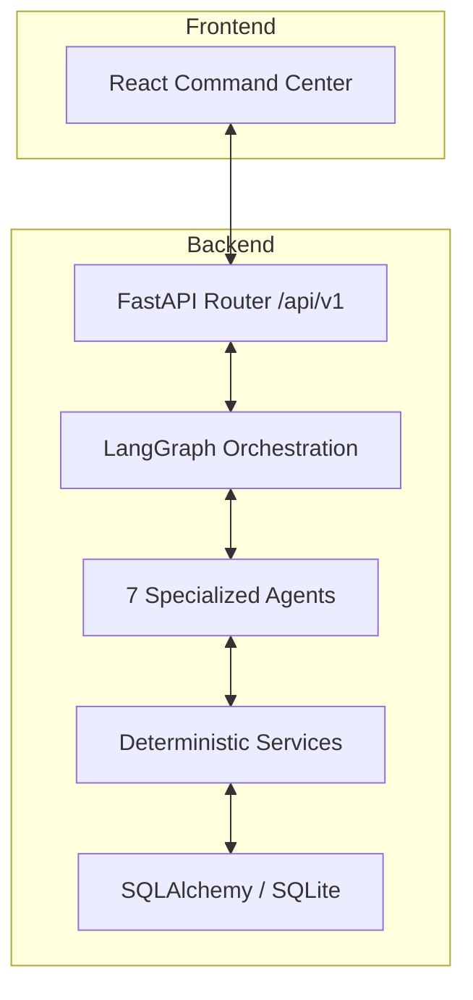

::: {align="center"}
# 🩸 RHEON AI

> **Predict. Orchestrate. Respond.**

**Agentic AI-powered emergency blood supply intelligence and coordination prototype.**

*Moving beyond fragmented supply decisions toward explainable, adaptive, and deterministic emergency response.*

[](https://www.python.org/)
[](https://fastapi.tiangolo.com/)
[](https://www.sqlite.org/)
[]()
[]()
:::

---

## 📑 Table of Contents

- [✨ Overview](#-overview)
- [🎯 The Problem](#-the-problem)
- [💡 The RHEON Solution](#-the-rheon-solution)
- [🔄 How RHEON Works](#-how-rheon-works)
- [🏗️ System Architecture](#️-system-architecture)
- [🚀 Key Capabilities](#-key-capabilities)
- [🧠 Agentic AI Architecture](#-agentic-ai-architecture)
- [🛡️ Deterministic Safety and Validation](#️-deterministic-safety-and-validation)
- [🔁 Adaptive Re-Planning](#-adaptive-re-planning)
- [⚠️ Hard Cases & Edge Handling](#️-hard-cases--edge-handling)
- [🧰 Technology Stack](#-technology-stack)
- [📁 Project Structure](#-project-structure)
- [⚙️ Installation & Setup](#️-installation--setup)
- [🧪 Testing and Verification](#-testing-and-verification)
- [🔐 Security Considerations](#-security-considerations)
- [📈 Engineering Principles](#-engineering-principles)
- [⚠️ Current Limitations](#-current-limitations)
- [🔮 Future Roadmap](#-future-roadmap)
- [🗺️ Development Roadmap](#-development-roadmap)
- [📚 Documentation Guide](#-documentation-guide)
- [🎯 Design Philosophy](#-design-philosophy)
- [👨‍💻 Author](#-author)

---

## ✨ Overview

In emergency blood coordination, locating potential supply is only the first step. Decision-makers must reconcile biological compatibility, usable inventory, safety-reserve floors, transport logistics, urgency, and sudden environmental disruptions.

**RHEON AI** is an agentic, multi-agent AI decision-support prototype. It harmonizes these factors into a unified emergency workflow. RHEON is engineered to evaluate supply feasibility, orchestrate specialized agents, generate allocation plans, explain trade-offs deterministically, and trigger re-planning when conditions shift.

> **The mission:** move beyond locating supply toward intelligent, explainable, and adaptive emergency coordination.

---

## 🎯 The Problem

Emergency blood coordination is hampered by fragmented, time-critical constraints:

1.  **Fragmented Visibility:** Supply data is often siloed across different facilities.
2.  **Time Sensitivity:** Logistics availability and transport time dictate source feasibility.
3.  **Inventory Uncertainty:** Gross recorded stock is rarely usable stock after accounting for mandatory safety reserves.
4.  **Dynamic Conditions:** Supply availability, route feasibility, or requisition urgency can change abruptly.
5.  **Explainability Gap:** Non-transparent recommendations cannot be trusted in high-stakes environments.

A robust coordination system must be capable of generating feasible plans, explaining its uncertainty, and honestly reporting when no valid solution exists.

---

## 💡 The RHEON Solution

RHEON integrates **agentic orchestration** with **deterministic operational verification**:

-   **Specialized Agents:** Domain-specific agents analyze inventory, demand, matching, logistics, donor pools, and explainability.
-   **Coordinator Executive:** A central orchestrator consolidates findings using LangGraph state management.
-   **Deterministic Engines:** Calculations for stock, reserves, travel corridors, and compatibility happen in verified Python code, never free-form LLM output.
-   **6-Point Safety Validation:** Candidate plans are rejected unless they pass deterministic feasibility gates.
-   **Adaptive Workflow:** Disruptions trigger assessment and re-planning only when required.
-   **Traceability:** RHEON documents the reasoning, options rejected, and trade-offs considered.

---

## 🔄 How RHEON Works



---

## 🏗️ System Architecture



---

## 🚀 Key Capabilities

| Capability | Purpose | Status |
| :--- | :--- | :---: |
| 🚨 **Emergency Request Workflow** | Adaptive orchestration for urgent blood requests | ✅ Implemented |
| 🩸 **Inventory Intelligence** | Usable stock calculation with reserve protection | ✅ Implemented |
| 🔎 **Candidate Source Matching** | Multi-criteria ranking across facilities | ✅ Implemented |
| 🚚 **Logistics Feasibility** | Ground-transit corridor routing & ETA calculation | ✅ Implemented |
| 🧠 **Multi-Agent Orchestration** | Cyclic/state-driven workflow management (LangGraph) | ✅ Implemented |
| 🔁 **Adaptive Re-Planning** | Automated disruption response and impact analysis | ✅ Implemented |
| 🛡️ **6-Point Validation** | Deterministic sanity checks for plans | ✅ Implemented |
| 🧪 **Simulation Boundary** | Non-clinical synthetic demonstration data | ✅ Implemented |

---

## 🧠 Agentic AI Architecture

Specialized agents operate through a centralized `AgentRegistry`.

| Agent | Responsibility |
| :--- | :--- |
| **Coordinator** | Central executive; manages workflow and re-planning. |
| **Inventory** | Calculates net usable units (gross minus reserves). |
| **Demand** | Assesses urgency, velocity, and surge indices. |
| **Matching** | Ranks candidates by weight (compat, capacity, ETA). |
| **Logistics** | Ground transit corridors and ETA computing. |
| **Donor** | Coordinates synthetic standby mobilization strategy. |
| **Explainability** | Safety validation and command briefing synthesis. |

> **Reasoning Principle:** Agents orchestrate logic and interpret findings. Deterministic Python services enforce safety.

---

## 🛡️ Deterministic Safety and Validation

**An AI recommendation is not automatically a valid plan.** RHEON enforces a strict separation:

```
                  ┌─────────────────────────────┐
                  │ Agent Findings / Candidate  │
                  └─────────────┬───────────────┘
                                ▼
                  ┌─────────────────────────────┐
                  │  6-Point Safety Validator   │
                  │ (Deterministic Python Code) │
                  └──────┬───────────────┬──────┘
                         ▼               ▼
                  ┌────────────┐   ┌────────────┐
                  │   VALID    │   │  INVALID   │
                  └────────────┘   └────────────┘
```

The 6-point safety gate verifies:
1. **Biological Compatibility:** ABO/Rh verification.
2. **Safety Reserve Floor:** Zero-breach guarantee for inventory.
3. **Logistics SLA:** Delivery window feasibility.
4. **Active Verification:** Facility operational checks.
5. **Quantity Invariant:** Integrity of allocated versus requested totals.
6. **Transport Integrity:** Cold-chain compliance and approved ground-only modalities.

---

## 🔁 Adaptive Re-Planning

When source inventory drops or transit routes face delays, RHEON behaves adaptively:

1. **Detection:** A supported disruption signal is received.
2. **Impact Assessment:** The coordinator identifies which findings are invalidated.
3. **Re-Evaluation:** Affected agents re-calculate candidates and logistics.
4. **Plan Generation:** A candidate alternative is generated.
5. **Validation:** The alternative is subjected to the 6-point check.
6. **Activation:** Replacement is initiated *only if* safety gates pass.

---

## ⚠️ Hard Cases & Edge Handling

| Case | Scenario | Implemented Behavior |
| :--- | :--- | :--- |
| **Infeasible Plan** | Insufficient stock, failed validation | Explicitly reports `FAILED` status |
| **Inventory Breach** | Stock drops below reserve floor | Rejected by safety gates |
| **Source Disruption** | Source fails transit SLA | Trigger re-plan and alternative lookup |
| **Missing Data** | Question out of synthetic scope | Returns `UNANSWERABLE` status |

---

## 🧰 Technology Stack

| Layer | Technology | Role |
| :--- | :--- | :--- |
| **Frontend** | React, Vite, TS | UI, Dashboard, Simulation command center |
| **Backend** | Python, FastAPI | REST API implementation |
| **Orchestration** | LangGraph | State-driven multi-agent orchestration |
| **Validation** | Pydantic | Schema-driven request/response validation |
| **Persistence** | SQLAlchemy, SQLite | Synthentic prototype storage |
| **Reasoning** | Anthropic Claude API | Agent orchestration and analysis |
| **Logic** | Deterministic Python | Operational calculators and safety gates |

---

## 📁 Project Structure

```text
Rheon/
├── backend/
│   ├── app/
│   │   ├── agents/          # Specialized agent registry
│   │   ├── orchestration/   # LangGraph workflow graphs
│   │   ├── services/        # Deterministic business logic
│   │   └── api/             # FastAPI endpoint routers
├── frontend/                # Vite React Command Center
└── docs/                    # Architectural specs and PRDs
```

---

## ⚙️ Installation & Setup

1. **Clone the Repo:**
   ```bash
   git clone <URL>
   cd Rheon
   ```

2. **Backend Setup:**
   ```bash
   cd backend
   python -m venv .venv
   .\.venv\Scripts\Activate.ps1    # PowerShell
   pip install -r requirements.txt
   ```

3. **Frontend Setup:**
   ```bash
   cd frontend
   npm install
   npm run dev
   ```

4. **Environment:**
   Create a `.env` file referencing `ANTHROPIC_API_KEY` for LLM capabilities. Never commit credentials.

---

## 🧪 Testing and Verification

RHEON includes a comprehensive `pytest` suite ensuring agentic workflows, deterministic services, and API endpoints function correctly:

```bash
# From backend directory:
pytest
```

> **Verified Evidence:** All 102 defined workflow and service tests passed in the current verified implementation.

---

## 🔐 Security Considerations

- **Read-Only Focus:** The system is purposefully constrained within prototype limits.
- **Deterministic Validation:** Safety logic is explicitly coded rather than relying on reasoning.
- **Synthentic Constraints:** No real patient or clinical data is used (synthetic only).
- **Tool-Based Dispatch:** Agent interaction with services/database is restricted by deterministic tool registries.

---

## 📈 Engineering Principles

- **Reasoning vs. Calculation:** Agents coordinate; deterministic services perform safety-critical calculations.
- **Explicit Failure:** Reporting "no feasible plan" is prioritized over generating invalid recommendations.
- **Traceable Adaptivity:** Plan changes triggered by disruptions are documented and history-linked.

---

## ⚠️ Current Limitations

- **Prototype Status:** Not an integrated or clinical management system.
- **Synthetic scope:** Data is simulated, not real-time clinical data.
- **Environment:** Designed for evaluation/demo, not production clinical availability.

---

## 🔮 Future Roadmap

- [ ] **Plan Arena:** Side-by-side comparison of feasible allocations.
- [ ] **Predictive Radar:** Forecasting supply pressure.
- [ ] **Live Integration:** Integrating verified real-world supply data streams.
- [ ] **Governance Hardening:** Adding RBAC and audit controls.

---

## 👨‍💻 Author

**Ayush Rawat**
*B.Tech Computer Science & Engineering, AI & Machine Learning*

---

::: {align="center"}
### 🩸 RHEON AI
**Predict. Orchestrate. Respond.**
:::
